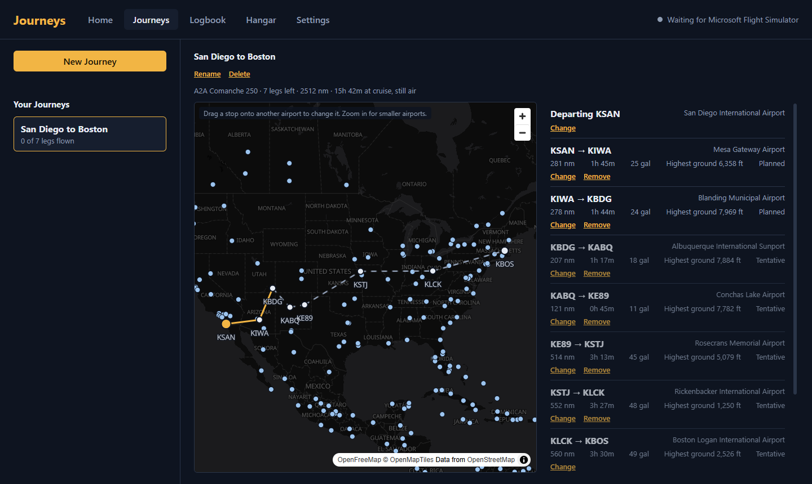
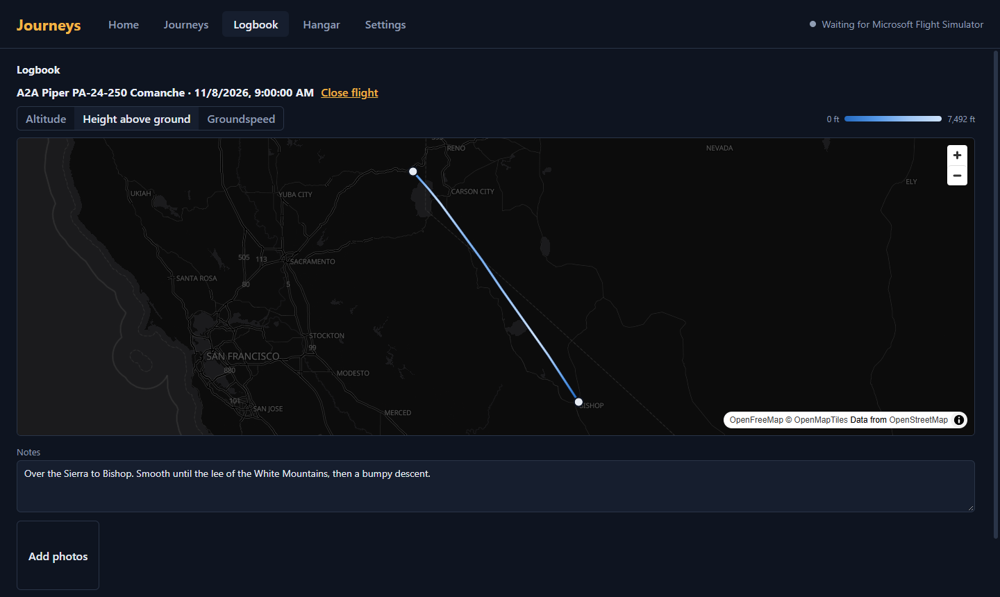

# Journeys

**A free companion app for Microsoft Flight Simulator 2024 that gives you a reason to keep flying.**

No economy, no career ladder, no grind. Pick somewhere you want to go, and Journeys turns it into a trip you fly a leg at a
time, over as many evenings as you like. It remembers where you left each aircraft, logs every flight, and keeps the story
of your travels. It never tells you what you can't do.



## What it does

- **Picks up where you left off.** Park an aircraft and Journeys remembers where it is, its fuel and its switches. Load it
  again tomorrow and it offers to put everything back.
- **Plans whole trips, not single flights.** "San Diego to Boston in the Comanche" becomes a chain of legs that fit your
  aircraft's range and how long you like to fly. Stop early, go further, drag a stop to another airport: the rest re-plans
  around what you actually did. You still set up each flight yourself, with whatever tools you like.
- **Respects the terrain.** Optionally keep legs under a ceiling, limit water crossings, or skip high airports.
- **Logs every flight in detail.** Path, times, fuel, landing rate, stalls and overspeeds. See any flight on a map coloured
  by altitude, height above ground or speed, add notes, and screenshots taken during a flight are added automatically.
- **Shows where you've been.** An atlas of every flight and airport, per-aircraft flight maps, and a live map of the flight
  you're on.
- **Helps you get set up.** A home screen with your next leg, and an optional pause before top of descent so you have time
  to brief the approach.
- **Works with AI assistants, if you want.** An optional, read-only connection lets apps like Claude Desktop answer "what am
  I flying over?" from your actual flight.



Everything stays on your computer. There are no accounts, and Journeys only connects to the internet for map tiles and
updates.

## Getting started

### 1. Install

1. Download the latest **`Journeys-Setup-x.y.z.exe`** from the [Releases page](https://github.com/codyspate/journeys/releases).
2. Run it. Journeys installs for your Windows user only (no admin needed) and opens.
3. **If Windows shows "Windows protected your PC":** click **More info**, then **Run anyway**. This appears because the
   installer isn't code-signed (see [Code signing policy](#code-signing-policy)).

Journeys updates itself: when a new version is out, it downloads quietly and offers to restart. It never restarts in the
middle of a flight.

### 2. Fly

1. Start Microsoft Flight Simulator 2024 and load a flight. Journeys connects on its own; the top-right corner turns green
   and says **Connected**.
2. **Plan a Journey:** on the **Home** or **Journeys** tab, pick where you're starting and where you want to end up, and
   choose your aircraft's numbers (a few presets are included). Journeys suggests the stops.
3. **Fly the first leg.** Take off from the departure airport. Journeys records the flight automatically, no buttons to
   press.
4. **Land and park** (stop, then set the parking brake or shut down). The flight is logged, the leg is ticked off, and the
   rest of the trip re-plans from wherever you actually landed. Your aircraft is saved where you left it.
5. **Next time,** open Journeys first. **Home** shows your next leg and whether your aircraft is ready for it. If it isn't
   where you left it, Journeys offers to put it back.

### Good to know

- **"No teleport" is on by default.** A flight is only logged if the aircraft takes off from where it last landed, so each
  aircraft's map is one continuous journey. Load it somewhere else and Journeys simply doesn't log that flight, and tells
  you why. Turn this off in **Settings** if you'd rather log everything.
- **Your data** lives in `%APPDATA%\journeys`. **Settings → Your data → Back up now** copies all of it into one folder.
  Updating or uninstalling never deletes it.
- **Restoring an aircraft** works best with standard aircraft and the A2A Comanche. Some study-level aircraft keep their own
  state, and a few switches may not come back. Journeys tells you exactly what did and didn't restore.

### Troubleshooting

- **Stuck on "Waiting for Microsoft Flight Simulator":** make sure MSFS 2024 is running and a flight is loaded (not just
  the main menu). Journeys retries every few seconds.
- **Maps are blank:** the map tiles come from the internet; check your connection or firewall.
- **Something else:** [open an issue](https://github.com/codyspate/journeys/issues) with what you did and what happened.
  A screenshot helps.

## Developing

Journeys is an [Electron](https://www.electronjs.org/) app written in TypeScript with React. You need **Windows**,
**[Node.js 24](https://nodejs.org/)** and **[Git](https://git-scm.com/)**. MSFS 2024 is only needed to try things against
the real sim; almost everything is covered by tests that run without it.

```bash
git clone https://github.com/codyspate/journeys.git
cd journeys
npm install
npm run dev        # start the app with hot reload
```

| Command | What it does |
| --- | --- |
| `npm run dev` | Runs the app; changes to the screens reload instantly |
| `npm test` | Runs the unit tests (no sim needed) |
| `npm run typecheck` | Checks types across the whole project |
| `npm run dist` | Builds the Windows installer into `release/` without publishing it |

Set `JOURNEYS_NO_SIM=1` to run a copy that never connects to the sim, handy for working on the app while you fly in
another copy.

### How the code is laid out

| Folder | What's in it |
| --- | --- |
| `src/core` | The heart of the app, with no Electron or sim dependency: the trip planner, flight recorder, aircraft save and restore, terrain, top-of-descent. Unit-tested against fakes. **Start here.** |
| `src/main` | Electron's main process: the SimConnect connection, SQLite storage, backups, updates, and the local endpoint for AI assistants. |
| `src/renderer` | The screens (React). Maps use [MapLibre](https://maplibre.org/). |
| `src/shared` | Types shared by both sides. |
| `src/preload` | The bridge between the screens and the main process. |
| `mcp` | The MCP server that AI apps start to read your flights. |
| `scripts` | Rebuild the airport and terrain data from their public sources. |
| `resources` | The bundled airport list and terrain grid. |
| `docs/SPEC.md` | The product spec: what Journeys is for and why. |

### Contributing

Contributions are welcome. See [CONTRIBUTING.md](CONTRIBUTING.md) for how to propose changes, and the two principles every
feature has to fit.

### Releasing

Releases are built by GitHub Actions. Set `version` in `package.json`, commit, then push a matching tag:

```bash
git tag v0.2.0
git push origin v0.2.0
```

The workflow tests, builds and publishes the installer, and installed copies update themselves.

## Data and credits

- Airports: [OurAirports](https://ourairports.com/data/) (public domain). Rebuild with `scripts/build-airports.mjs`.
- Terrain: [GMTED2010](https://www.usgs.gov/coastal-changes-and-impacts/gmted2010) maximum elevation, USGS (public
  domain). Coastlines and lakes: [Natural Earth](https://www.naturalearthdata.com/) (public domain). Rebuild with
  `scripts/build-terrain.py`.
- Maps: [OpenFreeMap](https://openfreemap.org/), with data © [OpenStreetMap](https://www.openstreetmap.org/copyright)
  contributors via [OpenMapTiles](https://openmaptiles.org/).
- Sim connection: [node-simconnect](https://github.com/EvenAR/node-simconnect) (LGPL-3.0).

Microsoft Flight Simulator is a trademark of Microsoft. Journeys isn't affiliated with or endorsed by Microsoft.

## Code signing policy

Journeys releases aren't code-signed, which costs money a free hobby project doesn't have. Windows SmartScreen will warn
the first time you run the installer; click **More info**, then **Run anyway**.

Every installer is built by [GitHub Actions](https://github.com/codyspate/journeys/actions) straight from the source in
this repository, never on someone's own computer, and published on the
[Releases page](https://github.com/codyspate/journeys/releases). Only download Journeys from there.

## License

Copyright © 2026 Cody Spate.

Journeys is free software: you can redistribute it and/or modify it under the terms of the
[GNU General Public License](LICENSE) as published by the Free Software Foundation, either version 3 of the License, or (at
your option) any later version. It comes with no warranty.
